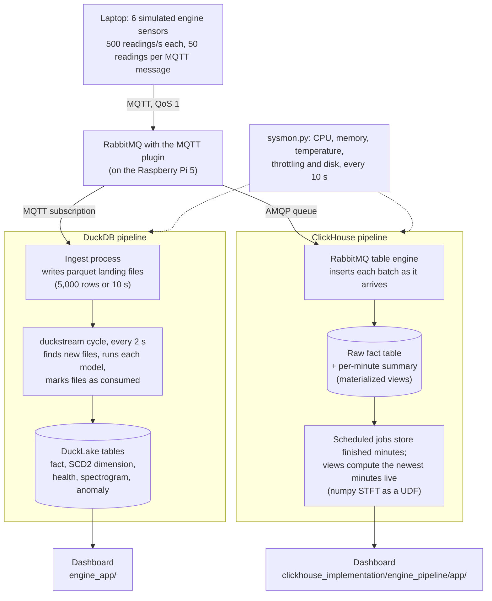

# Lakehouse RPi5: real-time sensor analytics on a Raspberry Pi 5

This repository holds two complete pipelines that turn a stream of engine
vibration readings into engine health data on a single Raspberry Pi 5, and the
study that compares them:

- a **DuckDB + DuckLake** pipeline, driven by **duckstream**, a small
  micro-batch streaming engine written for this project;
- a **RabbitMQ + ClickHouse** port of the same pipeline, with identical
  calculations.

Both were run for six hours on an uncooled Pi 5 under the same load (six
sensors at 500 readings per second each). Both stored every reading. ClickHouse
made readings available in about 3 ms and stayed flat for the whole run;
DuckDB took about 7 s and slowed down as the run went on.

Research project at Åbo Akademi University, supervised by Andreas Lundell and
Fredrik Hellman. The full write-up is the report:
[DuckDB_vs_ClickHouse_RPi5_report.pdf](clickhouse_implementation/engine_pipeline/research/DuckDB_vs_ClickHouse_RPi5_report.pdf).

## Results at a glance

| Measure (6 sensors, 3,000 readings/s) | DuckDB + duckstream | RabbitMQ + ClickHouse |
| --- | --- | --- |
| Readings stored in 6 hours | 51,300,100 of 51,300,100 | 51,300,100 of 51,300,100 |
| Received → stored, median | 6.9 s | 3 ms |
| Received → stored, end of run | 16.6 s, still rising | 3 ms |
| CPU of the pipeline's own processes | 165% of one core | 119% of one core |
| Memory when idle / at peak | 149 MB / 1,843 MB | 979 MB / 1,201 MB |
| Highest temperature (no cooling) | 84.8 °C, at the soft limit 49% of the time | 80.4 °C, never at the limit |
| Disk used for the 6-hour run | 3,304 MiB | 933 MiB |
| Per-minute health stored, median | about 8 s | 20–600 s (newest minutes are computed live instead) |

## What this project is

Sensors on an engine send vibration readings over MQTT. A Raspberry Pi 5 next
to the engines receives them, stores them in a star schema and computes, for
every machine and minute:

- health statistics: RMS, peak, crest factor, kurtosis, skew, axial ratio and
  RPM statistics;
- a spectrogram (short-time Fourier transform, 500 Hz, 512-sample Hann window);
- an anomaly score against the machine's own baseline.

A dashboard on the Pi shows all of this live, one engine at a time or side by
side. The aim is to do it all on the device, without a cloud back end.

## How the work developed

1. **Accelerometer lakehouse (first stage).** A batch pipeline on DuckDB and
   DuckLake: parquet files in, staging → curated → marts, an SCD2 dimension and
   an FFT mart. Described in
   [docs/accelerometer_batch_pipeline.md](docs/accelerometer_batch_pipeline.md).
2. **duckstream.** DuckDB has no built-in way to keep processing data as it
   arrives, so I wrote [duckstream](duckstream/): an ingest process lands MQTT
   readings as parquet files, and a pipeline loop picks up new files every few
   seconds, runs each model incrementally and records what it has consumed.
   Design notes are in [docs/duckstream/](docs/duckstream/).
3. **Engine vibration pipeline on DuckDB.** [engine_pipeline/](engine_pipeline/)
   uses duckstream to build the engine star schema, health, spectrogram and
   anomaly marts, shown by [engine_app/](engine_app/).
4. **ClickHouse port.** [clickhouse_implementation/](clickhouse_implementation/)
   rebuilds the same pipeline on RabbitMQ and ClickHouse, with every calculation
   checked against the original numpy code.
5. **Comparison.** Both pipelines got the same audit columns and were run for
   six hours each under the same load. The data, tools and report are in
   [clickhouse_implementation/engine_pipeline/research/](clickhouse_implementation/engine_pipeline/research/).

## Architecture

Both pipelines share the sensors and the broker. They differ in how a reading
gets from the broker into the tables.



The ClickHouse design follows one rule: store a result only once it can no
longer change. Minutes older than 10 minutes, and closed spectrogram minutes,
are stored by scheduled jobs; anything newer is calculated live from the raw
readings. duckstream instead stores every model's output in each cycle.

## The experiment

- **Device:** Raspberry Pi 5, 4 GB, SD card, Debian 13, with no heatsink, fan
  or case.
- **Load:** six simulated engines at 500 readings/s each, sent from a laptop
  over WiFi. One sensor was added every 30 minutes, so all six ran together
  for the last 3.5 hours.
- **Runs:** ClickHouse on 7–8 October 2026, DuckDB on 12 October 2026, six
  hours each, with the other pipeline switched off.
- **Measured:** every reading carries `sent_at`, `received_at` and `stored_at`
  audit columns, and a numbered sequence per sensor to detect loss. A
  monitoring script sampled the Pi every 10 seconds. Delay is measured from
  received to stored, on the Pi's clock only, because the laptop clock was
  not synchronised.

## Results

**Completeness.** Both pipelines stored all 51,300,100 readings, with no gaps
and no duplicates, at every sensor count.

**Delay.** ClickHouse stayed at 3 ms (median) from the first sensor to the
last hour. DuckDB was about 10 s with one sensor (a landing file closes after
5,000 rows or 10 s), fell to 1.2 s with three, and then rose steadily while the
load stayed constant: about 1.9 s per hour, reaching 16.6 s at the end.

| Sensors | ClickHouse median | DuckDB median | DuckDB 95th percentile |
| --- | --- | --- | --- |
| 1 | 3 ms | 10.0 s | 10.1 s |
| 2 | 3 ms | 4.2 s | 4.7 s |
| 3 | 3 ms | 1.2 s | 3.5 s |
| 4 | 3 ms | 4.3 s | 7.0 s |
| 5 | 3 ms | 4.0 s | 6.2 s |
| 6 | 3 ms | 6.9 s | 13.1 s |

**Why DuckDB slowed down.** Splitting each duckstream cycle into model work
and everything else shows that the models took under a second per cycle in
every hour. The other 90–92% of the cycle went to listing the landing folder
and tracking which files were new. With load held constant, the cycle grew
from 7.8 s to 11.6 s as landing files piled up (10,180 by the end). The cost
is in duckstream's file bookkeeping, not in DuckDB's calculations.

**CPU.** ClickHouse jumped to about 105% of a core with the first sensor and
then rose only to 119% with six, about 3% per extra sensor. DuckDB started at
61% and added about 21% per sensor, reaching 165%.

**Memory.** ClickHouse used a flat ~1 GB whatever the load. DuckDB started at
149 MB but grew with load and time, peaking at 1.8 GB.

**Temperature.** On the bare board, DuckDB's extra CPU kept the Pi at its
soft thermal limit (about 80 °C) for 49% of the six-sensor phase, peaking at
84.8 °C. ClickHouse peaked at 80.4 °C and never triggered the limit. Actual
clock throttling was rare in both runs.

**Storage.** DuckDB keeps each reading twice (landing file and lake table),
about 68 bytes per reading against at most 19 for ClickHouse. At 3,000
readings/s that is about 17.5 GB a day against 5 GB.

**Conclusion.** For continuous real-time work, ClickHouse was the better fit.
DuckDB remains a good choice where memory is tight or analysis runs
periodically rather than continuously. Its growing delay comes from the
duckstream design, which could likely be fixed by compacting or deleting
consumed landing files (not yet tested). The limits of the study (one run per
pipeline, minute-level delay samples, different days) are discussed in the
report.

## Repository layout

| Path | What it is |
| --- | --- |
| [duckstream/](duckstream/) | The micro-batch streaming engine for DuckDB / DuckLake |
| [docs/duckstream/](docs/duckstream/) | duckstream design, plan and status notes |
| [engine_pipeline/](engine_pipeline/) | Engine vibration pipeline on duckstream (ingest, models, star schema, producer) |
| [engine_app/](engine_app/) | Live dashboard for the DuckDB pipeline |
| [duckstream_pipeline/](duckstream_pipeline/) | The accelerometer pipeline rebuilt on duckstream |
| [clickhouse_implementation/engine_pipeline/](clickhouse_implementation/engine_pipeline/) | ClickHouse port: SQL, STFT UDF, dashboard, producer and launcher |
| [clickhouse_implementation/engine_pipeline/research/](clickhouse_implementation/engine_pipeline/research/) | Run exports, comparison tables, tools and the report |
| [clickhouse_implementation/pi_monitor/](clickhouse_implementation/pi_monitor/) | Small Pi CPU / memory / temperature dashboard |
| [clickhouse_implementation/mqtt_pipeline/](clickhouse_implementation/mqtt_pipeline/) | RabbitMQ MQTT setup and first experiments |
| [run_pipeline.py](run_pipeline.py), [sql/](sql/), [config/](config/) | The original accelerometer batch pipeline |
| [tools/](tools/), [tests/](tests/) | Soak and mutation tooling, tests |

## Running it

**DuckDB pipeline** (on the Pi, from the repository root, with the `.venv`
active). The ingest needs the RabbitMQ MQTT password in `ENG_MQTT_PASSWORD` or
asks for it.

```bash
./engine_pipeline/run_ingest.sh                       # MQTT -> landing files (keep running)
./engine_pipeline/run.sh --interval "2 seconds"       # duckstream cycle
ENG_ROOT=$HOME/engine-lake .venv/bin/python -u engine_app/server.py --port 8090
```

**ClickHouse pipeline** (on the Pi). See
[clickhouse_implementation/engine_pipeline/README.md](clickhouse_implementation/engine_pipeline/README.md)
for the full setup, including installing the STFT UDF.

```bash
cd clickhouse_implementation/engine_pipeline
./setup.sh                                            # creates the database, tables and jobs
CH_PASSWORD=... RMQ_PASSWORD=... python3 app/server.py   # dashboard on :8090
```

**Sensors** (on the laptop). The launcher starts one producer every 30 minutes
by default and stops them all at the end.

```bash
python clickhouse_implementation/engine_pipeline/run_producers.py --run-id ch_run1
python clickhouse_implementation/engine_pipeline/run_producers.py --run-id duck_run1 --topic engine/vibration_duck
```

**Rebuild the comparison and the report.**

```bash
.venv/bin/python clickhouse_implementation/engine_pipeline/research/tools/compare_runs.py
python3 clickhouse_implementation/engine_pipeline/research/report/build_report.py
```
